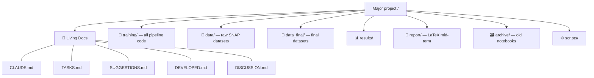
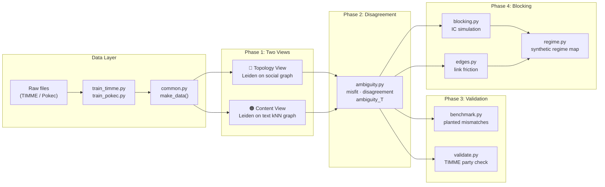
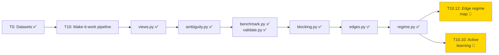

# Code Structure — Misinformation Propagation & Bridge Detection

## The Big Idea

> **Can we find the people who carry misinformation between social groups — and block them?**

You embed every user from *what they say* (text metadata) + *who they're connected to* (graph topology), cluster them two ways (structure vs. content), find where the clusterings **disagree** (ambiguous / bridge nodes), then test if blocking those nodes stops a simulated rumor cascade better than naive strategies (degree, PageRank, etc.).

---

## Repository Layout



| Directory / File | Purpose |
|---|---|
| [`TASKS.md`](file:///Users/abhyudayavasisht/Desktop/college/Major%20project%20/TASKS.md) | **Single source of truth** — task IDs (T0–T10), status, what's done vs. blocked |
| [`DEVELOPED.md`](file:///Users/abhyudayavasisht/Desktop/college/Major%20project%20/DEVELOPED.md) | What has been built, how it works, and why — pipeline documentation |
| [`SUGGESTIONS.md`](file:///Users/abhyudayavasisht/Desktop/college/Major%20project%20/SUGGESTIONS.md) | Design decisions and trade-offs (S-xx keyed to T-x) |
| [`DISCUSSION.md`](file:///Users/abhyudayavasisht/Desktop/college/Major%20project%20/DISCUSSION.md) | Cross-session disagreements to resolve |
| [`training/`](file:///Users/abhyudayavasisht/Desktop/college/Major%20project%20/training) | **All pipeline code** (22 Python files + notebooks) |
| [`data_final/`](file:///Users/abhyudayavasisht/Desktop/college/Major%20project%20/data_final) | Final datasets: TIMME, Gab, Reddit, VoterFraud (gitignored) |
| [`data/`](file:///Users/abhyudayavasisht/Desktop/college/Major%20project%20/data) | Raw SNAP data: Pokec (1.8 GB), Orkut, Facebook/Twitter ego nets |
| [`report/`](file:///Users/abhyudayavasisht/Desktop/college/Major%20project%20/report) | LaTeX mid-term report (IEEE format) |
| [`archive/`](file:///Users/abhyudayavasisht/Desktop/college/Major%20project%20/archive) | Old exploratory notebooks, VGAE outputs, reserve loaders |
| [`docs/`](file:///Users/abhyudayavasisht/Desktop/college/Major%20project%20/docs) | `MODELS.md` (why BGRL/DGI/MVGRL), research papers, project ideas |
| [`results/`](file:///Users/abhyudayavasisht/Desktop/college/Major%20project%20/results) | Output sub-dirs: blocking, detection, GNN embeddings, regime, scores, views |

---

## Pipeline Architecture

There are **two pipelines** — the original GNN-based one (T2–T5, now superseded) and the current "make-it-work" pipeline (T10):

### Current Pipeline (T10 — `views → ambiguity → blocking → regime`)



### Original GNN Pipeline (T2–T5, superseded but code still present)

```
raw files → loader → common.make_data → gclib.run_all → out/<ds>/*_emb.pt + metrics.json
                                         BGRL | DGI | MVGRL
                                              ↓
                              metrics.py / eval_embeddings.py / plot_umap.py
```

---

## Key Source Files in `training/`

### Data & Preprocessing

| File | Lines | Role |
|---|---|---|
| [`common.py`](file:///Users/abhyudayavasisht/Desktop/college/Major%20project%20/training/common.py) | 143 | `remap_ids()`, `make_data()` (symmetrize, LCC, standardize), `encode_texts()` (multilingual MiniLM, 384-d), CLI args |
| [`train_timme.py`](file:///Users/abhyudayavasisht/Desktop/college/Major%20project%20/training/train_timme.py) | ~120 | TIMME P_all loader — reads 5 relation files, bio+tweet text, party labels |
| [`train_pokec.py`](file:///Users/abhyudayavasisht/Desktop/college/Major%20project%20/training/train_pokec.py) | ~170 | Pokec loader — 1.63M nodes, `--region` for slicing, interest text + demographics |

### GNN Embedding (original pipeline)

| File | Lines | Role |
|---|---|---|
| [`gclib.py`](file:///Users/abhyudayavasisht/Desktop/college/Major%20project%20/training/gclib.py) | 472 | **Core GNN library** — 2-layer GCN encoder shared by BGRL/DGI/MVGRL; training loop with augmentation (20% edge/feature dropout); best epoch by modularity; early stopping; sparse CSR adjacency; resumable checkpoints |
| [`metrics.py`](file:///Users/abhyudayavasisht/Desktop/college/Major%20project%20/training/metrics.py) | ~310 | `report()` — 4-section eval: health (collapse detection), labeled (probe/NMI/ARI), unlabeled (modularity/conductance), task (boundary-betweenness overlap) |
| [`test_gclib.py`](file:///Users/abhyudayavasisht/Desktop/college/Major%20project%20/training/test_gclib.py) | ~100 | Verifies sparse GCN matches edge-list GCN (outputs + gradients) |
| [`eval_embeddings.py`](file:///Users/abhyudayavasisht/Desktop/college/Major%20project%20/training/eval_embeddings.py) | ~60 | Loads saved `.pt` embeddings, runs full `metrics.report`, refuses stale files |
| [`plot_umap.py`](file:///Users/abhyudayavasisht/Desktop/college/Major%20project%20/training/plot_umap.py) | ~150 | UMAP grid: models × colourings (clusters, labels, degree) |

### Make-It-Work Pipeline (T10)

| File | Lines | Role |
|---|---|---|
| [`views.py`](file:///Users/abhyudayavasisht/Desktop/college/Major%20project%20/training/views.py) | 242 | **Phase 1** — Two clean partitions: (T) Leiden on social graph, (C) Leiden on cosine kNN graph of raw text vectors. Scored by modularity, party NMI, degree η², seed stability |
| [`ambiguity.py`](file:///Users/abhyudayavasisht/Desktop/college/Major%20project%20/training/ambiguity.py) | 223 | **Phase 2** — `p_T` (label spreading on graph), `p_C` (cross-fitted text classifier). Outputs: **misfit** (1 − p_C[own community]), **disagreement** (JS divergence of p_T vs p_C), **ambiguity_T** (structural entropy). Baselines: consensus entropy, participation coefficient, content outlier |
| [`benchmark.py`](file:///Users/abhyudayavasisht/Desktop/college/Major%20project%20/training/benchmark.py) | ~150 | **Phase 3a** — Planted mismatch tests: swap node text across communities, measure detection AUC |
| [`validate.py`](file:///Users/abhyudayavasisht/Desktop/college/Major%20project%20/training/validate.py) | ~90 | **Phase 3b** — TIMME party-label validation: are misfit-flagged nodes more often in the wrong party cluster? |
| [`blocking.py`](file:///Users/abhyudayavasisht/Desktop/college/Major%20project%20/training/blocking.py) | 263 | **Phase 4a** — Independent Cascade simulation: remove k nodes under various strategies (random, degree, PageRank, betweenness, CI, content-weighted gateway, ambiguity); measures infected share + cross-community spread |
| [`edges.py`](file:///Users/abhyudayavasisht/Desktop/college/Major%20project%20/training/edges.py) | 191 | **Phase 4b** — Link-level intervention: add friction to edges instead of removing nodes. Scores: bridge_struct (structure-only), bridge_content (PR × receptivity from text), bridge_struct_x_recv |
| [`regime.py`](file:///Users/abhyudayavasisht/Desktop/college/Major%20project%20/training/regime.py) | ~160 | **Phase 4c** — Synthetic regime map: 72 settings × 2 seeds; identifies when content-aware targeting beats centrality (strong agreement effect + hub mismatches) |
| [`check_modularity.py`](file:///Users/abhyudayavasisht/Desktop/college/Major%20project%20/training/check_modularity.py) | ~85 | Measures graph modularity vs degree-preserving rewired null (are the communities real?) |
| [`disagreement.py`](file:///Users/abhyudayavasisht/Desktop/college/Major%20project%20/training/disagreement.py) | ~200 | Older T4/T5 disagreement draft (HDBSCAN + FINCH), superseded by ambiguity.py |

---

## Datasets

| Dataset | Nodes (LCC) | Edges | Text Features | Labels | Status |
|---|---|---|---|---|---|
| **TIMME P_all** | 20,811 | 6.5M (5 relation types) | Bio + latest tweet → MiniLM 384-d | 1,206 R/D party | ✅ Primary |
| **Pokec** | 1.63M | 30.6M directed | Interest text (Slovak) → MiniLM + gender/age/region | None | ✅ Secondary |
| Gab | 336k users | Repost/reply/quote | Post body text | None | 🔄 Reserve |
| Reddit | 67k subreddits | 858k hyperlinks | Subreddit embeddings (46% coverage) | None | 🔄 Reserve |

> [!IMPORTANT]
> All text across all datasets goes through one multilingual sentence encoder (`paraphrase-multilingual-MiniLM-L12-v2`, 384-d). Nodes without text get a zero vector + `has_metadata=0` flag.

---

## Current Status (as of 2026-10-04)



**Key finding:** The original GNN embeddings produced degenerate clusters (Q ≤ 0), so the plan pivoted to T10's two-clean-views approach. On TIMME, betweenness/PageRank beat content-aware blocking strategies; content targeting only wins at strong agreement effect + hub-placed mismatches (a narrow regime). The thesis has been reframed as a **detector + regime map** rather than a universal blocking win.

### What's Left
- **T10.12** — Edge-level regime map + thesis write-up
- **T10.10** — Active learning with disagreement-chosen queries (pending advisor approval)
- **T9.4** — Mid-term report (mostly done, LaTeX in `report/`)
